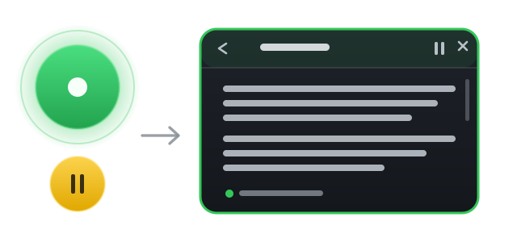

# 每日秘书（daily-secretary）

一个 [DeepSeek Harness（DSH）](https://github.com/deepseek-ai/deepseek-harness) 插件。它按需截取屏幕画面，将画面整理成带时间线的工作记录，并生成每日小结；桌面圆点可以随时暂停或恢复记录。



## 功能

- 单击桌面圆点开始或暂停记录；双击查看当天的小结。
- 默认暂停。只有主动开始后才会截屏。
- 定时汇总截屏为详细记录，并在每天指定时间生成小结。
- 在 DSH 设置页调整截屏间隔、汇总频率、每日小结时间和总结模型。
- 截屏、日记和状态文件保存在插件数据目录中。
- 可选注册 `daily_secretary` 工具，让 Agent 查看状态、读取记录或控制暂停状态。

## 安装

### 系统要求

- Windows x64
- 已安装并配置好的 DSH
- 建议在 DSH 中选择支持图片输入的模型，以便总结实际屏幕内容

插件包已包含 Windows x64 所需的截屏程序和桌面组件。安装者不需要单独安装 Rust、编译程序、设置环境变量或填写可执行文件路径。

### 从 DSH 安装

1. 打开 DSH 侧栏中的 **Plugins**。
2. 选择 **Add plugin → Install a third-party plugin**。
3. 输入 `github:Fulisike/daily-secretary` 并安装。
4. 安装完成后启用 **daily-secretary**。

安装通过 DSH 自带的插件管理器完成，不需要单独运行构建命令。也可参考 [DSH 官方插件文档](https://github.com/deepseek-ai/deepseek-harness/blob/master/docs/user/develop/basic/publish.md)。

## 首次使用

插件启动后默认处于暂停状态，桌面圆点为黄色。单击圆点开始记录，绿色表示正在记录；再次单击即可暂停。双击圆点可查看当天的小结。

在 DSH 侧栏底部打开「设置」→「每日秘书」，可以修改截屏间隔、记录节奏、每日小结时间和总结模型。默认跟随当前 profile 使用的模型。

## 隐私与数据

截屏和生成的日记保存在本机插件数据目录。生成记录和每日小结时，相关截屏及文字会发送给 DSH 当前使用的模型服务；请根据所选服务的隐私政策和使用费用作出选择。

## 已知限制

- 当前预编译安装包支持 Windows x64。
- 截屏只覆盖主显示器。
- DSH 未运行期间不会继续截屏；重新启动后会尝试整理尚未处理的截图。
- 不支持图片输入的模型只能根据时间线生成记录，无法识别截图内容。

## 开发

```powershell
node --test
node scripts/build-native.mjs
```

`node --test` 运行项目测试。`build-native.mjs` 用于维护者重新构建桌面组件；普通安装者使用仓库内的预编译文件，无需安装 Rust。

记录算法、目录结构、配置项和安全边界见[技术说明](docs/DETAIL.zh.md)。

## 许可证

本项目采用 [MIT License](LICENSE)。`scrabber` 截屏程序来自[上游项目](https://github.com/arividar/scrabber)，其源码和许可证信息以该项目为准。
